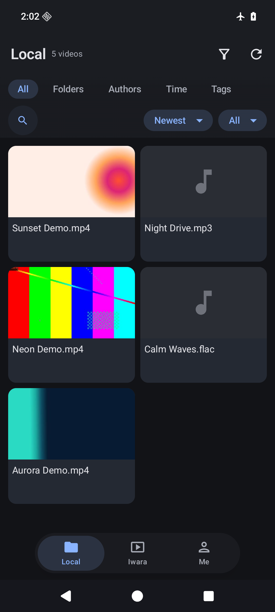
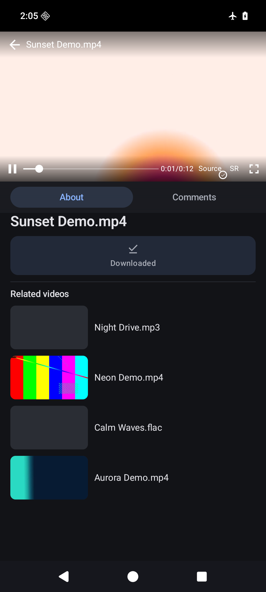
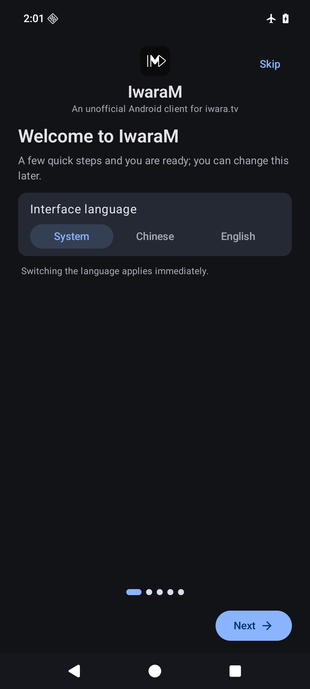

<div align="center">

[简体中文](README.zh-CN.md) · **English**

</div>

<p align="center">
  
</p>

<h1 align="center">IwaraM</h1>

<p align="center">An unofficial Android client for <a href="https://iwara.tv">iwara.tv</a> — browse the site, keep a searchable local library, and watch videos with optional GPU-accelerated super resolution.</p>

<p align="center">
  <a href="https://github.com/Amatsuki-Ichika/IwaraM/actions/workflows/ci.yml"></a>
  <a href="https://developer.android.com/about/versions/oreo"></a>
  <a href="LICENSE"></a>
  <a href="https://kotlinlang.org"></a>
  <a href="https://github.com/Amatsuki-Ichika/IwaraM/releases/latest"></a>
</p>

<div align="center">





</div>

<div align="center">

[Library](docs/assets/screenshots/library-en.png) · [Player](docs/assets/screenshots/player-en.png) · [First-run guide](docs/assets/screenshots/onboarding-en.png)

</div>

> **Not affiliated with iwara.tv.** This is a community project and an independent client.
> The service may contain adult material — see [DISCLAIMER.md](DISCLAIMER.md) before using it.

## Features

- **Online browsing** — trending and latest feeds, tag browsing, search and author pages.
- **Local library** — import and scan media folders, fetch metadata, then browse by folder,
  author, date or tag with search and sorting. The scanner indexes video files (MP4, MKV, WebM and
  MOV, plus TS, M2TS, FLV, OGV, AVI, 3GP and 3G2) and audio files (MP3, M4A, AAC, FLAC, OGG, Opus,
  WAV, AMR and MKA); audio entries show a music-note placeholder and play audio-only.
- **Playback** — swipe to seek, double-tap to seek, fullscreen, quality selection and
  resume from where you left off. If the device's preferred decoder fails to initialise, the player
  retries the next available decoder; a playback error offers "Open in another app" for files the
  device cannot decode. Codec support still varies by device and OS.
- **Super resolution** — optional Anime4K shader models running on the GPU.
- **Downloads** — background downloads with resume.
- **Watch history** — automatic history with one-tap resume.
- **Favourites and playlists** — browse and manage your account's collections.
- **Content filter** — global include/exclude rules for titles and tags, plus an R18 toggle.
- **Bilingual UI** — Simplified Chinese and English, switchable in Settings › General › Language;
  the app follows the system language by default.
- **First-run guide** — the first launch walks through language, library folder and download
  folder; replay it from Settings › About.
- **Material 3 UI** — light and dark themes with a choice of accent colours, and an optional
  frosted-glass treatment for the bars.

## Install

Download the latest APK from the [releases page](https://github.com/Amatsuki-Ichika/IwaraM/releases/latest)
and install it. Release candidates are published on the same releases page and marked as
pre-releases; the link above always points at the latest stable build. The current stable release
is **0.2.1**.

The build targets **arm64-v8a** devices running **Android 8.0 (API 26)** or newer.

Each release is signed with the same certificate, so a later version can normally be installed
over an older one; a build signed by anyone else cannot — uninstall it first if you are coming
from a different build. There is one exception: 0.2.0 changed the application ID from 0.1.0, so
Android treats them as different apps — uninstall and reinstall, or keep both side by side. The
library index, watch history and settings from 0.1.0 do not migrate; media files in folders you
chose are untouched. Verify a download as described in [SECURITY.md](SECURITY.md).

## Build from source

Requirements:

- JDK 17
- Android SDK with platform `android-37.2` and build-tools `36.0.0`

```bash
# Point Gradle at your SDK (local.properties is git-ignored).
echo "sdk.dir=$ANDROID_HOME" > local.properties

./gradlew :app:test            # unit tests
./gradlew :app:assembleDebug   # debug APK
./gradlew :app:assembleRelease # signed release APK; needs keystore.properties, see CONTRIBUTING.md
```

The version name has a single source of truth in `gradle.properties` (`app.versionName`) and can be
overridden per build with `-Papp.versionName=0.2.1`; `versionCode` is derived from it in
`app/build.gradle.kts` (`major * 10000 + minor * 100 + patch`, pre-release suffix ignored).

## Architecture

A single-activity Compose app with a hand-written overlay stack and a repository layer over Room
and Retrofit. There are only two app-scoped, shared ViewModels — `VideoViewModel` for the local
library and `IwaraClientViewModel` for online browsing — deliberately without a DI framework or a
navigation library. See [docs/architecture.md](docs/architecture.md) for the module map and the
conventions used in this codebase.

## Contributing

Bug reports and pull requests are welcome — please read [CONTRIBUTING.md](CONTRIBUTING.md)
first. This project follows the [Contributor Covenant](CODE_OF_CONDUCT.md).

## License

[GNU Affero General Public License v3.0](LICENSE) © IwaraM contributors.

IwaraM is free software: you can redistribute it and/or modify it under the terms of the
AGPL-3.0. A modified version offered to users over a network must also offer them its source.
Bundled Anime4K shaders are MIT-licensed by their authors; every third-party component keeps its
own licence — see [NOTICE.md](NOTICE.md) for the full list.

## Acknowledgements

- [Anime4K](https://github.com/bloc97/Anime4K) by bloc97 for the super-resolution shaders.
- [AndroidLiquidGlass](https://github.com/Kyant0/AndroidLiquidGlass) by Kyant0 for the
  backdrop effect used by the frosted-glass bars.
