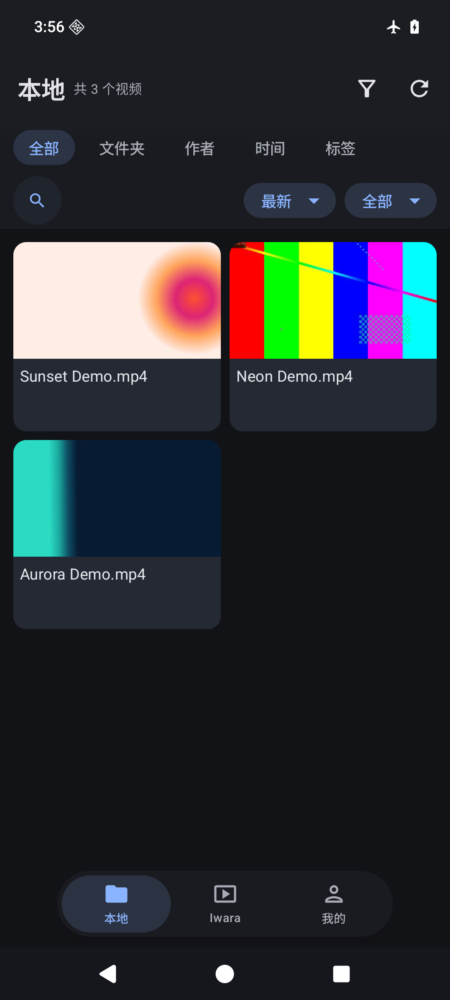
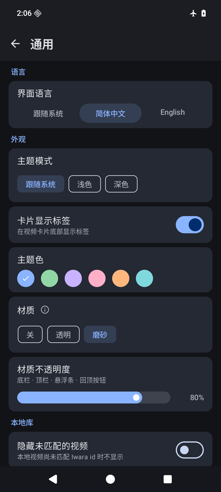
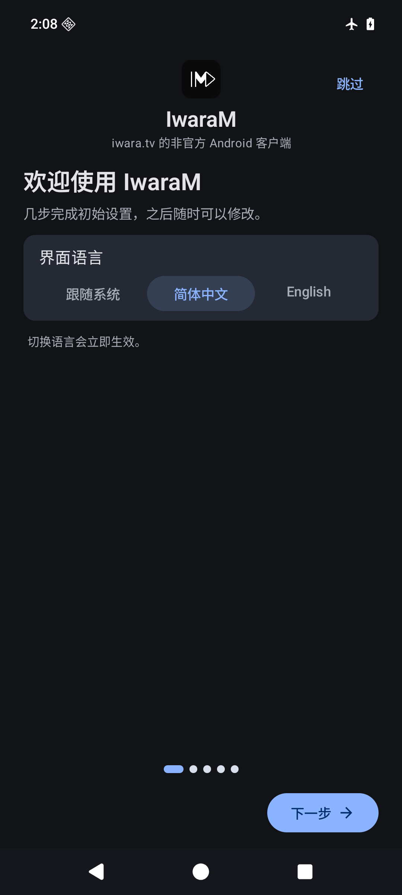

<div align="center">

**简体中文** · [English](README.md)

</div>

<p align="center">
  
</p>

<h1 align="center">IwaraM</h1>

<p align="center"><a href="https://iwara.tv">iwara.tv</a> 的非官方 Android 客户端，Kotlin + Jetpack Compose 编写：浏览站点内容、维护可搜索的本地库，并支持可选的 GPU 超分辨率播放。</p>

<p align="center">
  <a href="https://github.com/Amatsuki-Ichika/IwaraM/actions/workflows/ci.yml"></a>
  <a href="https://developer.android.com/about/versions/oreo"></a>
  <a href="LICENSE"></a>
  <a href="https://kotlinlang.org"></a>
  <a href="https://github.com/Amatsuki-Ichika/IwaraM/releases/latest"></a>
</p>

<div align="center">





</div>

<div align="center">

[本地库](docs/assets/screenshots/library-zh.png) · [设置](docs/assets/screenshots/settings-zh.png) · [首次引导](docs/assets/screenshots/onboarding-zh.png)

</div>

> **与 iwara.tv 无任何隶属关系。** 本项目是社区独立客户端。站点可能包含成人内容，
> 使用前请阅读 [DISCLAIMER.md](DISCLAIMER.md)。

## 功能

- **在线浏览** —— 热门/最新信息流、标签浏览、搜索、作者页。
- **本地库** —— 导入并扫描媒体目录、抓取元数据，再按文件夹 / 作者 / 日期 / 标签浏览，
  支持搜索与排序。扫描器会索引 MP4、MKV、WebM 与 MOV 视频。
- **播放** —— 左右滑动定位、双击定位、全屏、清晰度选择、从上次进度续播。音频由内置的
  FFmpeg 解码器解码，设备平台解码器拒绝的音频流也能播放；视频解码器则通过 ExoPlayer 的
  解码器回退依次重试。实际编解码能力仍取决于设备与系统。
- **超分辨率** —— 可选的 Anime4K 着色器模型，运行在 GPU 上。
- **下载** —— 后台下载并支持断点续传。
- **观看历史** —— 自动记录，一键续播。
- **收藏与播放列表** —— 浏览并管理账号下的收藏与播放列表。
- **内容筛选** —— 针对标题与标签的全局包含/排除规则，以及 R18 显示开关。
- **双语界面** —— 简体中文与 English，可在「设置 › 通用 › 语言」切换；默认跟随系统语言。
- **首次引导** —— 首次启动时依次介绍界面语言、本地库文件夹与下载文件夹；可在「设置 ›
  关于」中重新查看。
- **Material 3 界面** —— 浅色/深色主题与可选主题色，顶栏/底栏可选磨砂玻璃材质。

## 安装

前往 [Releases 页面](https://github.com/Amatsuki-Ichika/IwaraM/releases/latest) 下载最新 APK 安装。
构建目标为 **arm64-v8a**、**Android 8.0（API 26）** 及以上。

测试版（RC）也会发布在 [Releases 页面](https://github.com/Amatsuki-Ichika/IwaraM/releases)并标注为
pre-release；上面的下载链接始终指向最新的正式版（当前为 0.2.1）。

每个版本都用同一张证书签名，因此后续版本通常可以原地覆盖安装；由他人签名的包则不能——
若你之前用的是别的签名包，请先卸载。例外：0.1.0 到 0.2.0 更换了 `applicationId`，Android
视为另一个应用，必须卸载重装或并存安装；本地库索引、观看历史与设置不会迁移，用户自选目录
里的媒体文件不受影响。校验下载文件的完整性与签名见 [SECURITY.md](SECURITY.md)。

## 从源码构建

前置条件：

- JDK 17
- Android SDK：平台 `android-37.2`、build-tools `36.0.0`

```bash
# 让 Gradle 找到你的 SDK（local.properties 已被 git 忽略）
echo "sdk.dir=$ANDROID_HOME" > local.properties

./gradlew :app:test            # 单元测试
./gradlew :app:assembleDebug   # Debug APK
./gradlew :app:assembleRelease # 签名 Release APK，需要 keystore.properties，见 CONTRIBUTING.md
```

版本名的唯一来源是 `gradle.properties` 里的 `app.versionName`，也可在构建时用
`-Papp.versionName=0.2.1` 覆盖；`versionCode` 由 `app/build.gradle.kts` 从版本名推导
（`major * 10000 + minor * 100 + patch`，忽略预发布后缀）。

## 架构

单 Activity 的 Compose 应用，配手写的覆盖层栈；数据层由 Repository 封装 Room 与 Retrofit。
全仓只有两个应用级共享的 ViewModel：`VideoViewModel` 管本地库，`IwaraClientViewModel` 管
在线浏览 —— 有意不引入 DI 框架与 Navigation 库。模块地图与代码约定见
[docs/architecture.md](docs/architecture.md)。

## 参与贡献

欢迎提交 issue 与 PR，请先阅读 [CONTRIBUTING.md](CONTRIBUTING.md)。本项目遵循
[贡献者公约](CODE_OF_CONDUCT.md)。

## 许可

本项目采用 [GNU Affero 通用公共许可证第 3 版（AGPL-3.0）](LICENSE) © IwaraM contributors。

IwaraM 是自由软件，可按 AGPL-3.0 条款重新分发或修改；将修改后的版本作为网络服务提供给
用户时，必须同时向这些用户提供其源代码。打包的 Anime4K 着色器由其作者以 MIT 许可发布，
其他三方组件保留各自的许可 —— 完整清单见 [NOTICE.md](NOTICE.md)。

## 致谢

- [Anime4K](https://github.com/bloc97/Anime4K)（bloc97）—— 超分辨率着色器。
- [AndroidLiquidGlass](https://github.com/Kyant0/AndroidLiquidGlass)（Kyant0）—— 磨砂玻璃栏所用的背景效果。
